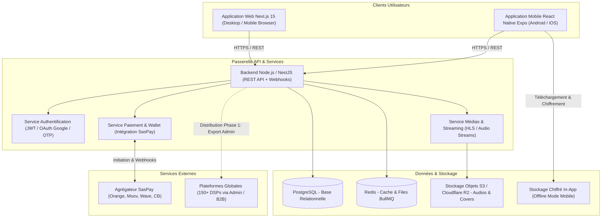
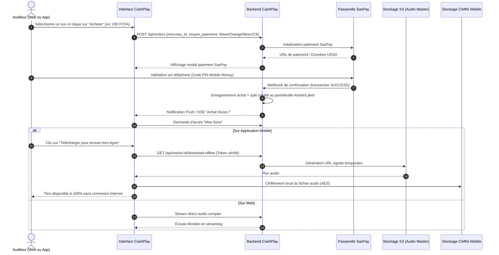

# Spécification Technique : Plateforme CashPlay Music (Web & Mobile)

- **Date :** 2026-11-12
- **Statut :** Proposé pour validation (Brainstorming validé)
- **Auteurs :** Maxime OUATTARA & Assistant Antigravity
- **Inspiration & Benchmark :** [Empire Afrique](https://empireafrique.com/) (modèle de distribution et vente directe de musique africaine avec paiement mobile et mode hors-ligne).

---

## 1. Contexte & Objectifs

### 1.1 Contexte du projet
En Afrique de l'Ouest (notamment au Burkina Faso et dans l'espace UEMOA), le marché de la musique souffre d'un manque d'infrastructures de distribution légale adaptées aux habitudes de paiement locales (Mobile Money) et d'un taux élevé de piratage. Les plateformes internationales (Spotify, Apple Music, Deezer) restent peu accessibles en raison de l'obligation de posséder une carte bancaire internationale et d'un modèle de streaming rémunérant très faiblement les créateurs locaux.

**CashPlay Music** comble ce fossé en fournissant un écosystème tout-en-un réunissant :
1. **La vente directe et le streaming** avec paiement instantané par Mobile Money (Orange Money, Moov Money, Wave) et Cartes Bancaires.
2. **Une distribution accessible aux artistes indépendants et aux labels** sans abonnement annuel obligatoire pour les artistes (paiement à l'acte), et un forfait label annuel dédié.
3. **Une protection anti-piratage** avec écoute in-app et téléchargement hors-ligne sécurisé (à l'image d'Empire Afrique).
4. **Une accessibilité multi-supports** : Web réactif + Application Mobile native (Android & iOS).

### 1.2 Identité Visuelle & Charte Graphique (Conforme au Brandboard CashPlay Music)
- **Palette Couleurs :**
  - Vert CashPlay (Primaire) : `#008A3B`
  - Vert Profond (Surfaces sombres & player) : `#006B2E`
  - Vert Pâle (Accents doux & badges) : `#E8F5ED`
  - Noir (Contraste & typographie) : `#111111`
  - Blanc (Fond & lisibilité) : `#FFFFFF`
  - Gris Neutre (Textes secondaires & bordures) : `#5E6661`
- **Typographie :** Famille *Montserrat* (ExtraBold pour titres, SemiBold pour menus/boutons/prix, Regular pour corps de texte).
- **Signature :** *« La musique prend de la valeur. »*

---

## 2. Exigences Fonctionnelles (Spécifications Métier)

### Profils Utilisateurs
La plateforme gère 4 profils distincts :
- **Visiteur non connecté** (Écoute d'extraits, découverte du catalogue).
- **Auditeur** (Achat de sons, écoute hors-ligne, playlists, parrainage).
- **Artiste** (Distribution à l'acte, fixation des prix, stats, retraits dès 500 FCFA).
- **Label** (Abonnement 15 000 FCFA/an, gestion multi-artistes, split de commissions).
- **Administrateur** (Modération, validation des sorties globales, gestion des reversements).

---

### EF-01 : Page d'Accueil & Découverte sans compte
- **Comportement :**
  - Splash screen avec logo CashPlay Music au centre puis fondu vers l'accueil.
  - Organisation du catalogue : Nouveautés, Top Ventes, Playlists thématiques, Sélection par genre musical (Afrobeat, Rap/Hip-Hop, Reggae, Musique Traditionnelle, Gospel, etc.).
  - Lecteur audio persistant en bas d'écran.
  - Bannière promotionnelle/publicitaire en en-tête.
  - Écoute d'extraits limitée (30 à 45 secondes) pour les visiteurs anonymes.
- **Règle de conversion :**
  - Un popup d'invitation à l'inscription apparaît après **30 secondes** d'utilisation anonyme, proposant la connexion/création de compte via Email, Numéro de téléphone ou Google OAuth en 1 clic.

### EF-02 : Authentification & Gestion des Comptes
- Authentification unifiée pour Web et Mobile :
  - Identifiants : Email + mot de passe ou Numéro de téléphone (avec validation OTP SMS) ou Google Sign-In.
  - Sélection du type de compte à l'inscription : **Auditeur**, **Artiste**, **Label**.
  - Récupération de mot de passe sécurisée.
  - Revendication de profil : un artiste dont les titres ont été mis en ligne par l'équipe technique CashPlay peut réclamer son profil officiel sur présentation de justificatifs.

### EF-03 : Lecteur Audio & Expérience d'Écoute
- **Lecteur Web :**
  - Barre de lecture persistante en bas de page (Play, Pause, Suivant, Précédent, Barre de progression fluide, Contrôle du volume, Répéter, Aléatoire).
  - Gestion des extraits (audio court) vs sons complets achetés.
- **Lecteur Mobile :**
  - Lecture audio fluide en **arrière-plan** (`background playback`).
  - Commandes multimédia sur l'écran de verrouillage (`Lockscreen`) et le centre de contrôle notification (titre, artiste, pochette, play/pause/seek).
  - Maintien de l'écoute continue sans interruption lors de la navigation dans l'app.

### EF-04 : Système de Paiement Localisé (Passerelle SasPay)
- Intégration de l'agrégateur **SasPay** pour couvrir les paiements et retraits en zone UEMOA / Burkina Faso :
  - **Moyens de paiement acceptés :** Orange Money, Moov Money, Wave, Carte Bancaire (Visa/Mastercard).
  - **Usages de paiement :**
    1. Achat de singles/albums par les auditeurs.
    2. Règlement des frais de distribution par les artistes.
    3. Règlement de l'abonnement annuel des labels.
  - **Gestion des webhooks :** Validation automatique et asynchrone des transactions (crédit instantané du son dans la bibliothèque de l'acheteur dès confirmation du webhook SasPay).

### EF-05 : Achat & Mode Hors-Ligne Sécurisé (Anti-Piratage)
- **Concept inspiré d'Empire Afrique / Spotify :**
  - Après achat d'un titre, celui-ci est rattaché au compte de l'auditeur dans son onglet **« Mes Sons »**.
  - Bouton « Télécharger pour écoute hors-ligne » disponible sur mobile :
    - Le fichier audio est streamé, découpé ou chiffré localement sur l'appareil (clé locale sécurisée).
    - **Aucun fichier MP3 en clair n'est déposé dans le dossier public / Téléchargements du smartphone**, empêchant le partage illégal via Bluetooth ou WhatsApp.
    - L'application mobile peut lire ces fichiers stockés sans aucune connexion Internet active.

### EF-06 : Espace Artiste (Distribution & Monétisation)
- **Tarifs de distribution unitaire (sans abonnement annuel) :**
  - **Single (1 titre) :** 2 000 FCFA
  - **EP (2 à 6 titres) :** 5 000 FCFA
  - **Album (+ de 6 titres) :** 7 000 FCFA
  - **Option Distribution Globale (+150 plateformes, délai 14 jours) :** Case à cocher ajoutant **+30 %** au montant initial (ex: Single global = 2 600 FCFA).
- **Processus de mise en ligne :**
  - Upload des pistes audio (MP3 jusqu'à 10 Mo par titre, 320 kbps recommandé).
  - Upload de la pochette (format carré min 1400x1400 px, JPG/PNG).
  - Métadonnées complètes : Titre, Artiste principal, Featurings, Genre, Année, Auteur/Compositeur, Description.
  - Fixation libre du prix unitaire de vente par l'artiste (ex: 200 FCFA, 500 FCFA, etc.).
- **Tableau de bord Artiste :**
  - Suivi des ventes et du nombre d'écoutes en temps réel.
  - Solde des revenus nets disponibles.
  - Bouton de demande de retrait : Seuil minimal de **500 FCFA** (reversement direct via Mobile Money SasPay après validation).

### EF-07 : Espace Label & Roster
- **Abonnement annuel Label :** 15 000 FCFA / an.
- **Fonctionnalités Label :**
  - Création et gestion d'une liste d'artistes rattachés au label.
  - Définition du pourcentage de répartition des revenus (*revenue split*) pour chaque artiste (ex: 70% Label / 30% Artiste).
  - Distribution de projets (Singles, EP, Albums) pour le compte de ses artistes selon les mêmes tarifs de distribution.
  - Suivi analytique consolidé : chiffre d'affaires global, part reversée à chaque artiste, marge nette du label.
  - Les artistes du label peuvent consulter leur profil revendiqué et ne voient que leur part contractuelle.
  - Si l'abonnement annuel du label n'est pas renouvelé à l'échéance, les titres du label sont temporairement gelés à l'achat et à l'écoute.

### EF-08 : Programme d'Affiliation & Viralité
- Chaque auditeur dispose d'un **lien de parrainage unique**.
- Règle de récompense : Lorsque **5 personnes** s'inscrivent via son lien et effectuent un premier achat musical, l'auditeur gagne automatiquement **1 téléchargement gratuit** (crédit d'achat d'un titre de son choix).
- Bouton de partage natif (Web Share API sur le web, partage direct WhatsApp/Facebook/X sur mobile).

### EF-09 : Fonctions Communautaires
- Commentaires sous les titres et albums (avec filtre anti-spam).
- Système de Likes (favoris ajoutés à la playlist « Titres aimés »).
- Partage de liens profils et morceaux générant des aperçus riches (OpenGraph cards sur réseaux sociaux).

### EF-10 : Back-Office Administrateur
- Validation / contrôle qualité des morceaux téléversés (conformité audio, droits, pochettes).
- Module de gestion des demandes de distribution globale (export des packages audio/métadonnées pour déploiement sur les plateformes internationales).
- Validation et exécution des retraits de fonds (Mobile Money).
- Gestion des bannières publicitaires et statistiques globales de la plateforme.

---

## 3. Architecture & Choix Techniques

### 3.1 Stack Technologique Retenue

| Composant | Technologie | Justification |
| :--- | :--- | :--- |
| **Monorepo / Workspace** | Turborepo ou structure modulaire | Partage des types TypeScript, schémas de validation et utilitaires communs. |
| **Backend API** | Node.js (NestJS ou Express/TypeScript) | Écosystème robuste, gestion asynchrone des uploads, intégration facile de SasPay et des webhooks. |
| **Base de Données** | PostgreSQL + Prisma ORM | Modèle relationnel strict indispensable pour la comptabilité, les splits financiers, les transactions et les droits. |
| **Cache & Files d'attente** | Redis + BullMQ | Traitement asynchrone de l'encodage audio, génération des extraits de 30s et notifications. |
| **Stockage Fichiers (Audio & Images)** | Stockage Compatible S3 (Cloudflare R2 ou MinIO/AWS S3) | Zéro frais d'egress avec Cloudflare R2, idéal pour le streaming audio intensif à coût maîtrisé. |
| **Frontend Web** | Next.js 15 (App Router, React 19, Tailwind CSS) | SEO optimal pour le référencement des artistes et des morceaux, rapidité de chargement, lecteur audio global. |
| **Application Mobile** | React Native + Expo (TypeScript) | Déploiement unique pour iOS et Android, accès direct aux modules audio natifs (`react-native-track-player`). |
| **Paiement & Cashout** | Passerelle SasPay (Orange Money, Moov, Wave, CB) | Agrégateur ouest-africain adapté aux réalités du marché burkinabè et régional. |

---

### 3.2 Diagramme d'Architecture Globale (Mermaid)

---

### 3.3 Diagramme de Flux d'Achat & Écoute Hors-Ligne

---

## 4. Modèle de Données Conceptuel (Entités Clés)

1. **User :** `id`, `nom`, `email`, `telephone`, `role` (LISTENER, ARTIST, LABEL, ADMIN), `avatar_url`, `statut`, `created_at`.
2. **ArtistProfile :** `id`, `user_id`, `nom_scene`, `biographie`, `photo_pro_url`, `liens_sociaux` (JSON), `solde_retirable`, `statut_revendique`.
3. **LabelProfile :** `id`, `user_id`, `nom_label`, `date_expiration_abonnement`, `solde_retirable`.
4. **LabelArtistRelation :** `id`, `label_id`, `artist_id`, `pourcentage_artist`, `pourcentage_label`.
5. **Release (Projet) :** `id`, `titre`, `type` (SINGLE, EP, ALBUM), `cover_url`, `createur_type` (ARTIST / LABEL), `createur_id`, `option_distribution_globale` (boolean), `statut` (DRAFT, PENDING_REVIEW, PUBLISHED), `prix_total`.
6. **Track (Piste) :** `id`, `release_id`, `titre`, `duree_secondes`, `audio_master_url`, `audio_preview_url` (extrait 30s), `prix_unitaire`, `nombre_ecoutes`, `nombre_ventes`.
7. **Order & Transaction :** `id`, `user_id`, `track_id` / `release_id`, `montant`, `fournisseur` (SASPAY), `statut` (PENDING, COMPLETED, FAILED), `saspay_ref`, `created_at`.
8. **Withdrawal (Demande de retrait) :** `id`, `beneficiaire_id`, `beneficiaire_type`, `montant` (>= 500 FCFA), `numero_mobile_money`, `statut` (PENDING, APPROVED, PAID, REJECTED).
9. **Affiliation :** `id`, `parrain_id`, `filleul_id`, `a_achete` (boolean), `credit_recompense_attribue`.

---

## 5. Contraintes Globales, Sécurité & Performance

- **Sécurité des Médias :**
  - Fichiers maîtres audio inaccessibles directement (URLs pré-signées à durée de vie courte de 60 secondes pour le streaming).
  - Génération automatique des extraits de 30 secondes pour le streaming public.
- **Gestion SasPay :**
  - Contrôle d'idempotence sur les webhooks SasPay pour éviter tout double crédit.
  - Signature cryptographique des requêtes sortantes et entrantes.
- **Règles Réseau & Offline :**
  - L'application mobile doit continuer à lire la musique sans coupure lors des pertes momentanées de connexion réseau 3G/4G (mise en mémoire tampon optimisée).
- **Légalité & Modération :**
  - Conditions générales d'utilisation stipulant la cession des droits de diffusion et certifiant l'authenticité de l'œuvre par l'artiste téléverseur.

---

## 6. Critères de Succès & Recette

- [ ] L'internaute écoute un extrait de 30 secondes sur le Web et le Mobile sans créer de compte ; le popup de conversion s'ouvre à 30 secondes.
- [ ] Création de compte fluide par Email, Téléphone ou Google.
- [ ] Le lecteur audio fonctionne de manière continue en tâche de fond sur smartphone avec contrôles de lecture sur l'écran verrouillé.
- [ ] Un auditeur peut acheter un morceau via SasPay (Orange, Moov, Wave, CB) et l'écouter instantanément.
- [ ] Sur mobile, le téléchargement in-app permet l'écoute complète en mode avion, sans laisser de fichier MP3 exploitable hors de l'app.
- [ ] Un artiste peut publier un Single (2 000 FCFA), un EP (5 000 FCFA) ou un Album (7 000 FCFA), cocher l'option globale (+30%) et régler par SasPay.
- [ ] Un label peut souscrire à son abonnement de 15 000 FCFA/an, enregistrer des artistes et paramétrer le split de gains.
- [ ] L'artiste peut demander un retrait direct vers son compte Mobile Money dès que son solde atteint 500 FCFA.
- [ ] Le parrainage (5 achats via lien d'affiliation) crédite automatiquement un téléchargement gratuit à l'auditeur.
